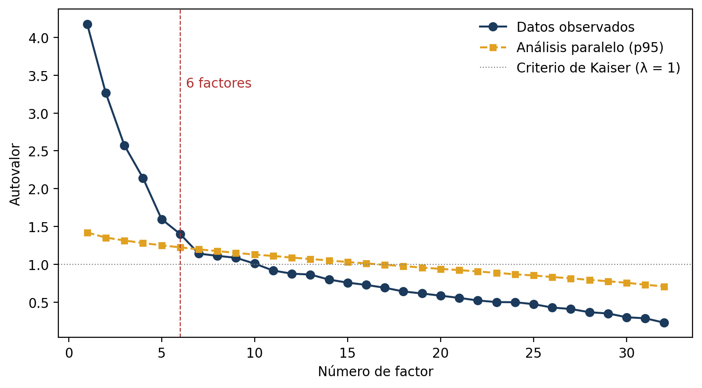
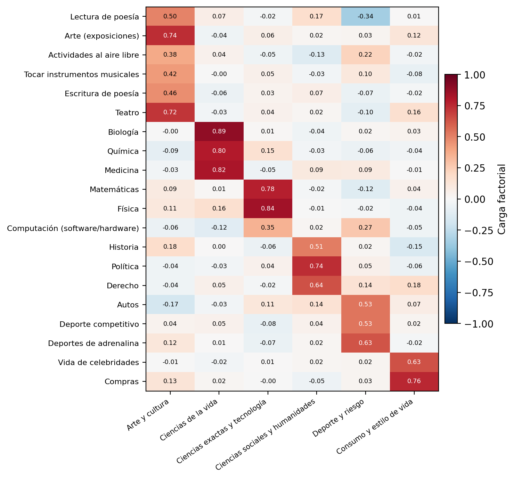
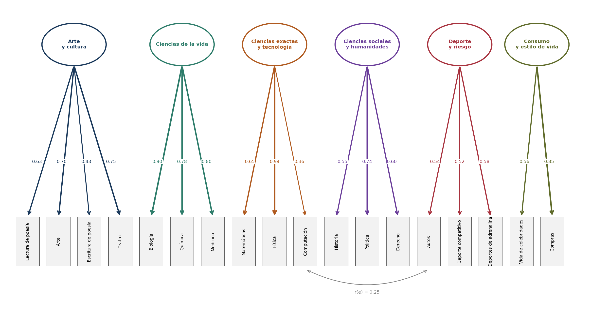
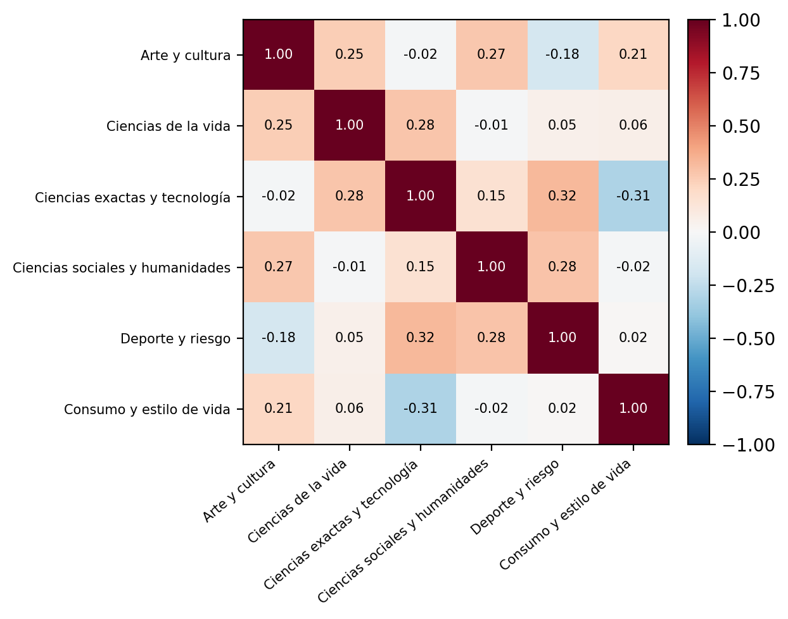

<!--
GUÍA PARA EDITAR ESTE INFORME
- Los datos de la portada están en el bloque de arriba (entre las líneas ---).
- # = encabezado de nivel 1 (APA: centrado, negrita); ## = nivel 2; ### = nivel 3.
- Tablas y figuras siguen el patrón APA: **Tabla N** / *Título en cursiva* / tabla o imagen / *Nota.* texto.
- Las figuras se leen de la carpeta resultados/, que genera analisis_factorial.py.
- Un comentario HTML con la palabra «salto» fuerza un salto de página en el PDF (en GitHub no se ve).
- Para generar el PDF en formato APA: python generar_pdf_apa.py
-->

# Resumen

Se analizó la estructura latente de los intereses de 886 jóvenes de 15 a 30 años a partir de los 32 ítems del bloque «Hobbies e intereses» de la encuesta *Young People Survey*. Las pruebas previas respaldaron el análisis (KMO = 0,76; prueba de Bartlett χ²(496) = 7395,3, *p* < 0,001). El análisis paralelo indicó 6 factores. El análisis factorial exploratorio (AFE) por máxima verosimilitud con rotación promax, tras depurar 12 ítems, produjo una solución de 20 ítems y seis factores interpretables (Arte y cultura, Ciencias de la vida, Ciencias exactas y tecnología, Ciencias sociales y humanidades, Deporte y riesgo, y Consumo y estilo de vida) que explica el 46,4 % de la varianza. En el análisis factorial confirmatorio (AFC), el modelo derivado (M1) mostró un ajuste marginal (CFI = 0,851; RMSEA = 0,070). El modelo ajustado (M2), con 18 ítems y una covarianza de errores justificada, mejoró el ajuste (CFI = 0,890; TLI = 0,858; RMSEA = 0,066; SRMR = 0,065): aceptable según RMSEA y SRMR, pero por debajo del umbral en los índices incrementales. La estabilidad de la estructura se comprobó reestimando el AFC por separado en dos mitades aleatorias de la muestra, que reproducen el ajuste de la muestra completa (CFI = 0,889 en ambas). Todos los factores cumplen el criterio de validez discriminante de Fornell-Larcker; en cuanto a la convergencia, el AVE alcanza 0,50 en 2 de los 6 factores y la fiabilidad compuesta alcanza 0,70 en 3 de 6, de modo que solo Ciencias de la vida cumple ambos criterios a la vez. El análisis de residuos reveló que el género organiza parte de la covarianza no explicada, lo que orienta los siguientes pasos.

*Palabras clave:* análisis factorial exploratorio, análisis factorial confirmatorio, bondad de ajuste, intereses vocacionales, Python

<!-- salto -->

# Modelado de Estructuras Latentes: Análisis Factorial Aplicado a los Intereses de Jóvenes

Los intereses de una persona (lo que le gusta leer, estudiar o hacer en su tiempo libre) no se observan como un todo, sino a través de muchas preferencias concretas. El análisis factorial permite pasar de esas decenas de preferencias a unas pocas dimensiones latentes que las explican. Este informe aplica el análisis factorial exploratorio (AFE) para descubrir esas dimensiones y el análisis factorial confirmatorio (AFC) para poner a prueba el modelo de medición resultante, siguiendo el flujo propuesto en la lectura fundamental de la unidad (Rojas Mora, s. f.).

El objetivo general es identificar, modelar y validar la estructura latente de los intereses de jóvenes a partir de un conjunto de 32 variables cuantitativas. Los objetivos específicos son:

1. Evaluar la factibilidad del análisis factorial mediante la medida KMO y la prueba de esfericidad de Bartlett.
2. Determinar el número de factores y extraerlos por máxima verosimilitud con rotación oblicua.
3. Proponer y justificar conceptualmente un modelo de medición.
4. Contrastar el modelo mediante AFC y evaluar su ajuste, fiabilidad y validez.

# Método

## Fuente de Datos

Se utilizó la base *Young People Survey*, publicada en Kaggle por Sabo (s. f.). Contiene las respuestas de 1010 personas de nacionalidad eslovaca, de 15 a 30 años, a un cuestionario de 150 preguntas aplicado en 2013 por estudiantes de la Facultad de Ciencias Sociales y Económicas de la Universidad Comenius de Bratislava. El archivo `responses.csv` contiene los datos y `columns.csv`, el diccionario que relaciona cada columna con la pregunta original.

## Variables Seleccionadas y Justificación

De las secciones del cuestionario (música, películas, hobbies, fobias, salud, rasgos de personalidad, gastos y demografía) se seleccionó el bloque completo «Hobbies e intereses»: 32 ítems en los que cada persona indica cuánto le interesa un tema, en una escala de 1 (*nada interesado*) a 5 (*muy interesado*). El bloque es adecuado por tres razones: (a) cumple el requisito de al menos 20 variables cuantitativas relacionadas; (b) todos los ítems comparten formato y escala, condición deseable para el análisis factorial; y (c) existe teoría previa sobre la estructura de los intereses, como el modelo RIASEC de Holland (1997) y la dimensión «personas–cosas» descrita por Su et al. (2009), lo que permite contrastar la solución empírica con expectativas conceptuales. El Apéndice A lista los 32 ítems con su pregunta original y sus estadísticos descriptivos.

## Tratamiento de Datos Faltantes y Supuestos

Ningún ítem supera el 1,5 % de respuestas vacías, pero al combinarlos 124 personas tienen al menos un faltante. Se aplicó eliminación por lista, con lo que quedaron *n* = 886 casos completos, una muestra amplia para el análisis factorial (más de 27 casos por variable). Las medias van de 1,89 («Escritura de poesía») a 4,55 («Socializar con amigos»), y las asimetrías, de -1,62 a 1,24. La prueba de Mardia (1970) rechazó la normalidad multivariada (curtosis multivariada = 1131,7 frente a 1088 esperado; *z* = 13,93, *p* < 0,001), algo esperable en ítems Likert de cinco puntos. Conviene precisar que se calculó con los 32 ítems del bloque y no con los 18 que entran finalmente en el AFC, de modo que parte de esa desviación procede de ítems que después se eliminaron; además, la aproximación asintótica de la curtosis multivariada pierde fiabilidad cuando *p* es grande, por lo que el *p* reportado debe leerse con cautela. Ambas salvedades se retoman como limitación. Esta condición se retoma como limitación en la discusión.

## Procedimiento de Análisis

El análisis se realizó en Python 3 con las librerías `pandas`, `factor_analyzer` (AFE) y `semopy` (AFC; Igolkina y Meshcheryakov, 2020). El código completo está en el archivo `analisis_factorial.py`, que genera todas las tablas y figuras de este informe; se fijó la semilla aleatoria 2026 para garantizar la reproducibilidad.

# Resultados

## Análisis Factorial Exploratorio

### Factibilidad del Análisis

La medida de adecuación muestral KMO global fue 0,762, valor que Kaiser (1974) califica de intermedio (*middling*) y que supera el umbral de 0,70 recomendado por Yong y Pearce (2013). Las medidas individuales (MSA) oscilaron entre 0,636 («Matemáticas») y 0,845 («Arte (exposiciones)»); ningún ítem quedó por debajo de 0,50, de modo que ninguno se excluyó por este criterio. La prueba de esfericidad de Bartlett fue significativa, χ²(496) = 7395,32, *p* < 0,001, por lo que se rechaza que la matriz de correlaciones sea una matriz de identidad. Ambas pruebas respaldan la aplicación del AFE.

### Número de Factores

Se contrastaron tres criterios. El criterio de Kaiser (autovalores mayores que 1) sugiere 10 factores, pero es conocido que sobreestima el número de factores cuando hay muchas variables. El gráfico de sedimentación muestra un cambio de pendiente entre el quinto y el séptimo autovalor. El análisis paralelo de Horn (1965), que compara cada autovalor observado con el percentil 95 de los autovalores de 500 matrices de datos aleatorios del mismo tamaño, es el criterio que suele recomendarse por su conservatism: el sexto autovalor observado (1,403) supera al aleatorio (1,227), pero el séptimo (1,144) ya no (1,201). Por tanto, se retienen 6 factores (ver Figura 1).

**Figura 1**

*Gráfico de sedimentación y análisis paralelo*



*Nota.* La línea discontinua amarilla es el percentil 95 de autovalores de datos aleatorios (500 réplicas). Se retienen los factores cuyo autovalor observado supera esa línea.

Como comparación se revisaron también las soluciones de tres a siete factores (ver Tabla 1). Se incluyeron las soluciones con **menos** factores que el que indica el análisis paralelo porque el resultado final no alcanza 0,90 en CFI y TLI, y en esa situación la revisión estándar exige contrastar la estructura hacia abajo, no solo hacia arriba. La solución de seis factores es la más interpretable y la que explica más varianza sin fragmentar los dominios: con cinco, Matemáticas y Física se mezclan con Computación y Autos; con siete, el dominio de las ciencias exactas se divide en dos factores, {Matemáticas, Física} y {Internet, Computación, Ciencia y tecnología}, y quedan **dos** factores con solo dos ítems. La solución de cuatro factores es la más limpia en cuanto a composición —18 ítems y **ningún** factor con menos de tres indicadores— y por eso se considera con atención en la discusión; explica sin embargo 30,4 % de la varianza, frente al 38,6 % de la solución de seis factores sobre los mismos 32 ítems.

**Tabla 1**

*Comparación de soluciones alternativas (máxima verosimilitud, rotación promax, 32 ítems)*

| Factores (*k*) | Varianza acumulada | Ítems con carga ≥ 0,40 | Ítems retenidos tras depurar | Factores con < 3 ítems |
| :---: | :---: | :---: | :---: | :---: |
| 3 | 25,7 % | 16 | 16 | 0 |
| 4 | 30,4 % | 20 | 18 | 0 |
| 5 | 34,7 % | 21 | 18 | 1 |
| **6** | **38,6 %** | 20 | 20 | 1 |
| 7 | 41,7 % | 22 | 22 | 2 |

*Nota.* Las tres primeras columnas se calculan sobre los 32 ítems con la misma extracción y rotación. «Ítems retenidos tras depurar» aplica además el criterio de carga cruzada, y «Factores con < 3 ítems» cuenta los factores que quedan por debajo de tres indicadores: es el criterio que revela que la solución de seis factores ya contiene un factor de dos ítems, mientras que la de cuatro no contiene ninguno.

### Extracción, Rotación y Depuración de Ítems

Se usó máxima verosimilitud (ML) como método de extracción porque es el que permite continuar con el AFC bajo el mismo estimador. Se aplicó una rotación oblicua promax porque no hay razón teórica para suponer que los intereses son independientes entre sí; por ejemplo, el interés por la física y por la biología suelen ir juntos. La rotación varimax obliga a que los factores sean ortogonales, mientras que promax permite estimar sus correlaciones y, si estas fueran nulas, daría un resultado similar.

Con los 32 ítems, la solución explicó el 38,6 % de la varianza. Para depurar se aplicaron dos reglas habituales: retener un ítem solo si (a) su carga principal es mayor o igual que 0,40 y (b) ninguna carga cruzada alcanza 0,35. Se eliminaron 12 ítems: Psicología, Internet, Economía y gestión, Geografía, Idiomas extranjeros, Religión, Baile, Deporte recreativo, Jardinería, Ciencia y tecnología, Socializar con amigos, Mascotas. Conviene señalar que, en esta muestra, los 12 incumplían ya la condición (a): ninguno fue eliminado únicamente por su carga cruzada, de modo que el criterio (b) no tuvo efecto práctico sobre el resultado. Varios de ellos son temas transversales que interesan a perfiles muy distintos (Internet, Socializar con amigos, Idiomas) o que mezclan dos dominios (Ciencia y tecnología, Economía y gestión), por lo que no definen con claridad ningún factor. El Apéndice B presenta el detalle completo, con cargas y comunalidades.

### Solución Factorial Final

El AFE se reestimó con los 20 ítems retenidos (KMO = 0,726). La Figura 2 muestra la matriz de patrones: la mayoría de los ítems carga de forma clara en un solo factor. La solución explica el 46,4 % de la varianza total de los 20 ítems (ver Tabla 2).

Dos salvedades importan al leer esa figura. Primera: la depuración se aplicó a la solución inicial de 32 ítems y **no se volvió a comprobar tras la reestimación**. Al verificarlo sobre la solución final, dos ítems quedan por debajo del umbral declarado de 0,40 — Computación (0,348) y Actividades al aire libre (0,383) — y ambos son precisamente los que luego se eliminan en el AFC. Segunda: la carga cruzada de Lectura de poesía es de 0,338 sobre *Deporte y riesgo*, un 68 % de su carga principal de 0,495; no es una carga cruzada «pequeña», y es el ítem que concentra tres de los seis mayores residuos del AFC. Ambas salvedades se retoman como limitación.

**Figura 2**

*Matriz de cargas factoriales del AFE final (20 ítems)*



*Nota.* Extracción por máxima verosimilitud y rotación promax. Los colores indican la magnitud y el signo de la carga.

**Tabla 2**

*Varianza explicada por factor en el AFE final*

| Factor | Suma de cargas al cuadrado | % de varianza |
| :--- | :---: | :---: |
| Arte y cultura | 1,98 | 9,9 % |
| Ciencias de la vida | 2,16 | 10,8 % |
| Ciencias exactas y tecnología | 1,49 | 7,4 % |
| Ciencias sociales y humanidades | 1,30 | 6,5 % |
| Deporte y riesgo | 1,27 | 6,4 % |
| Consumo y estilo de vida | 1,09 | 5,5 % |
| Total | 9,29 | 46,4 % |

*Nota.* Con rotación oblicua los porcentajes por factor son aproximados, porque los factores comparten varianza.

Las correlaciones entre factores son bajas o moderadas (máximo |*r*| = 0,39). Las más altas son las de Arte y cultura con Consumo y estilo de vida (*r* = 0,39), Arte y cultura con Deporte y riesgo (*r* = -0,35) y Ciencias de la vida con Ciencias exactas (*r* = 0,32). Estas correlaciones confirman que la rotación oblicua era apropiada.

### Estabilidad de la Solución

Como verificación adicional, la muestra se dividió al azar en dos mitades y se reestimó el AFE en cada una. La similitud entre las cargas de ambas mitades se midió con el coeficiente de congruencia de Tucker, cuyos valores iguales o mayores que 0,95 indican factores prácticamente iguales, y los valores entre 0,85 y 0,94, similitud aceptable (Lorenzo-Seva y ten Berge, 2006). Arte y cultura (0,976), Ciencias de la vida (0,977) y Ciencias sociales (0,960) son muy estables; Ciencias exactas (0,908) y Consumo (0,889) son aceptables, y Deporte y riesgo (0,834) es el factor menos estable, un primer aviso que el AFC confirmará.

La réplica se extendió después al AFC, que hasta entonces no se había contrastado en mitades. Al reestimar el modelo final M2 por separado en cada mitad (*n* = 443 por mitad), los índices de ajuste se mantuvieron muy cerca de los de la muestra completa: CFI = 0,889 en ambas mitades frente a 0,890; TLI = 0,858 en ambas; RMSEA = 0,066 y 0,068 frente a 0,066; y SRMR = 0,066 y 0,072 frente a 0,065. La estructura es, por tanto, reproducible en submuestras, no un artefacto de la muestra completa. Debe señalarse que esta comprobación se aplicó únicamente al modelo final de 18 ítems, no al modelo inicial M1 de 20 ítems.

## Diseño del Modelo de Medición

A partir del AFE se propone un modelo de seis factores correlacionados. Cada factor se nombró según el contenido común de sus ítems y se vinculó con un referente conceptual (ver Tabla 3).

**Tabla 3**

*Modelo de medición propuesto (M1)*

| Factor latente | Indicadores derivados del AFE | Justificación conceptual |
| --- | --- | --- |
| Arte y cultura | Lectura de poesía, Arte (exposiciones), Actividades al aire libre, Tocar instrumentos musicales, Escritura de poesía, Teatro | Expresión artística y consumo cultural; tipo «Artístico» de Holland (1997). |
| Ciencias de la vida | Biología, Química, Medicina | Estudio de los seres vivos y la salud; núcleo de las carreras biosanitarias. |
| Ciencias exactas y tecnología | Matemáticas, Física, Computación (software/hardware) | Razonamiento formal y tecnología; tipos «Investigador» y «Realista» de Holland (1997). |
| Ciencias sociales y humanidades | Historia, Política, Derecho | Vida pública, instituciones y pasado; orientación hacia la sociedad. |
| Deporte y riesgo | Autos, Deporte competitivo, Deportes de adrenalina | Actividad física, competencia y emociones fuertes; búsqueda de sensaciones (Zuckerman, 1994). |
| Consumo y estilo de vida | Vida de celebridades, Compras | Moda, compras y vida de los famosos; orientación hacia el estilo de vida (solo dos indicadores). |

*Nota.* El factor de Consumo y estilo de vida queda con dos indicadores, el mínimo que permite identificar un factor. El de Ciencias exactas y tecnología incluye un ítem (Computación) cuya pertenencia es discutible, como se explica al presentar el AFC.

El modelo asume que (a) cada ítem mide un solo factor, sin cargas cruzadas; (b) los errores de medición son independientes; y (c) los seis factores pueden correlacionarse. En notación matricial corresponde a **X** = **Λξ** + **δ**, donde **Λ** contiene únicamente las cargas señaladas en la Tabla 3. En la sintaxis de `lavaan`, que también usa `semopy`, el modelo M1 se escribe así:

```
ArteCultura =~ LecturaPoesia + Arte + AireLibre + Instrumentos + EscrituraPoesia + Teatro
CienciasVida =~ Biologia + Quimica + Medicina
CienciasExactas =~ Matematicas + Fisica + PC
CienciasSociales =~ Historia + Politica + Derecho
DeporteRiesgo =~ Autos + DeporteCompetitivo + Adrenalina
Consumo =~ Celebridades + Compras
```

Se plantean tres hipótesis: H1, el modelo de seis factores reproduce adecuadamente la matriz de covarianzas observada; H2, los indicadores convergen en sus factores (cargas estandarizadas iguales o mayores que 0,50 y fiabilidad compuesta igual o mayor que 0,70); y H3, los factores son distinguibles entre sí (validez discriminante).

## Análisis Factorial Confirmatorio

### Especificación y Estimación

El AFC se estimó con la librería `semopy`, equivalente a `lavaan` de R, mediante máxima verosimilitud. La escala de cada factor se fijó igualando a 1 la carga del primer indicador. Se reportan cinco índices de ajuste: χ², CFI, TLI, RMSEA (con intervalo de confianza del 90 %) y SRMR, con los puntos de corte de Hu y Bentler (1999): CFI y TLI iguales o mayores que 0,95 (0,90 aceptable), RMSEA igual o menor que 0,06 (0,08 aceptable) y SRMR igual o menor que 0,08.

### Ajuste del modelo inicial (M1)

El modelo M1 (20 ítems) produjo χ²(155) = 823,97, *p* < 0,001; CFI = 0,851; TLI = 0,817; RMSEA = 0,070, IC 90 % [0,065, 0,075]; SRMR = 0,070. RMSEA y SRMR están en la zona aceptable, pero CFI y TLI quedan por debajo de 0,90: el ajuste es marginal y conviene buscar el origen del desajuste antes de aceptar el modelo.

Se revisaron dos fuentes de información. Primero, las cargas estandarizadas: tres indicadores quedaron por debajo de 0,40: Actividades al aire libre (λ = 0,29); Tocar instrumentos musicales (λ = 0,37); Computación (software/hardware) (λ = 0,39). Segundo, los residuos de correlación, es decir, la diferencia entre la correlación observada y la que reproduce el modelo, que señalan los pares de ítems peor explicados (ver Tabla 4).

**Tabla 4**

*Mayores residuos de correlación del modelo M1*

| Ítem 1 | Ítem 2 | Residuo de correlación |
| :--- | :--- | :---: |
| Autos | Computación (software/hardware) | 0,295 |
| Autos | Lectura de poesía | -0,232 |
| Lectura de poesía | Computación (software/hardware) | -0,221 |
| Historia | Lectura de poesía | 0,195 |
| Deportes de adrenalina | Actividades al aire libre | 0,192 |
| Computación (software/hardware) | Teatro | -0,186 |

*Nota.* Los valores positivos indican que dos ítems se relacionan más de lo que el modelo predice, y los negativos, menos. Los residuos absolutos mayores que 0,10 señalan zonas de desajuste. Se muestran los **seis** mayores de los diez que calcula el script; los cuatro restantes, en orden decreciente, son Biología–Computación (−0,184), Escritura de poesía–Tocar instrumentos musicales (+0,173), Medicina–Computación (−0,158) y Compras–Derecho (+0,134), y están disponibles en el archivo `resultados/12_residuos_M1.csv`.

El patrón de residuos es revelador. El mayor residuo (0,295) une Computación y Autos, que están en factores distintos; ambos tienen además residuos negativos con Lectura de poesía, y Computación también con Teatro. Este patrón coincide con la variable género, codificada como 1 = hombre y 0 = mujer (*n* = 883, porque tres de los 886 casos completos no tienen ese dato): Computación (*r* = 0,47) y Autos (*r* = 0,42) son los intereses más asociados a ser hombre, mientras que Compras (*r* = -0,40), Lectura de poesía (*r* = -0,37) y Teatro (*r* = -0,35) son los más asociados a ser mujer. Se trata de la dimensión «cosas–personas» documentada por Su et al. (2009): parte de la covarianza entre intereses no se debe a los seis factores, sino a un eje transversal ligado al género.

### Re-especificación: modelo ajustado (M2)

Siguiendo la recomendación de ajustar el modelo solo con justificación teórica (Kline, 2023), se hicieron tres cambios, cada uno respaldado tanto por los datos como por el contenido de los ítems:

- Se eliminó Actividades al aire libre (λ = 0,29): ya en el AFE era el ítem más débil del factor, su contenido (naturaleza, campo) es ajeno al dominio artístico-cultural y mostraba residuo positivo con Deportes de adrenalina.
- Se eliminó Tocar instrumentos musicales (λ = 0,37). El criterio declarado fue la carga estandarizada por debajo de 0,50 en M1, no el tipo de contenido del ítem: Escritura de poesía es igualmente una práctica de creación y se conserva, con λ = 0,43, porque la diferencia entre ambas es de 0,06. Conviene añadir que la pareja Escritura de poesía–Tocar instrumentos musicales presenta un residuo de correlación de +0,173, uno de los mayores de M1, lo que indica que el modelo subestima la covarianza entre ambos; liberar esa covarianza de errores habría sido una alternativa igualmente justificable a eliminar un ítem.
- Se conservó Computación (λ = 0,39) pese a su carga baja, porque sin ella el factor Ciencias exactas quedaría con dos indicadores, por debajo de los tres recomendados para una identificación robusta, y se liberó la covarianza de errores entre Computación y Autos: ambos ítems reflejan un interés técnico-mecánico común (máquinas, tecnología) que los seis factores no capturan.

La sintaxis añadida al modelo es `PC ~~ Autos`. No se aplicaron más modificaciones para no sobreajustar el modelo a esta muestra. La Tabla 5 compara el ajuste de ambos modelos.

**Tabla 5**

*Índices de bondad de ajuste de los modelos M1 y M2*

| Modelo | Ítems | χ² (*gl*) | *p* | CFI | TLI | RMSEA [IC 90 %] | SRMR |
| :--- | :---: | :---: | :---: | :---: | :---: | :---: | :---: |
| M1 | 20 | 823,97 (155) | < 0,001 | 0,851 | 0,817 | 0,070 [0,065, 0,075] | 0,070 |
| M2 | 18 | 581,29 (119) | < 0,001 | 0,890 | 0,858 | 0,066 [0,061, 0,072] | 0,065 |
| Criterio | | — | > 0,05 | ≥ 0,95 (0,90) | ≥ 0,95 (0,90) | ≤ 0,06 (0,08) | ≤ 0,08 |

*Nota.* Entre paréntesis se indica el umbral aceptable. Los niveles 0,95 y 0,06 de CFI, TLI y RMSEA proceden de Hu y Bentler (1999); el nivel aceptable 0,90 y 0,08, y el criterio SRMR ≤ 0,08, de Browne y Cudeck (1993) y Hair et al. (2010). En ambos modelos *p* < 0,001 para χ². Se omite deliberadamente el cociente χ²/*gl*: con *n* = 886 es muy sensible al tamaño de la muestra y no se recomienda en muestras grandes (Brown, 2015). El SRMR se calcula como la raíz del promedio de los residuales de correlación sobre los pares distintos, sin incluir la diagonal. Como M2 tiene menos ítems, los modelos no están anidados y se comparan por sus índices, no con una prueba de diferencia de χ².

El χ² sigue siendo significativo, lo que era previsible con *n* = 886, porque esta prueba es muy sensible al tamaño de la muestra (Brown, 2015). El RMSEA (0,066, con todo su intervalo de confianza por debajo de 0,08) y el SRMR (0,065) indican un ajuste aceptable: el error de aproximación por grado de libertad es moderado y los residuos promedio son pequeños. En cambio, CFI (0,890) y TLI (0,858) no alcanzan 0,90. El CFI depende de las correlaciones medias entre las variables: aquí la correlación absoluta media entre los 18 ítems es solo 0,13, de modo que el modelo nulo de referencia ya ajusta relativamente bien y el margen de mejora que miden los índices incrementales es estrecho. En conjunto, siguiendo el enfoque de múltiples indicadores, el ajuste de M2 se califica como aceptable en términos absolutos, pero mejorable, en línea con el ejemplo de la lectura de la unidad (CFI = 0,782; RMSEA = 0,078 para un modelo de cinco factores de personalidad). H1 se acepta solo parcialmente.

### Cargas Factoriales del Modelo Final

**Tabla 6**

*Cargas factoriales del modelo M2*

| Factor | Ítem | Carga no estandarizada | *z* | Carga estandarizada (λ) | *R*² |
| :--- | :--- | :---: | :---: | :---: | :---: |
| Arte y cultura | Lectura de poesía | 1,000 | fijada (= 1) | 0,629 | 0,395 |
| Arte y cultura | Arte (exposiciones) | 0,982 | 14,76 | 0,699 | 0,489 |
| Arte y cultura | Escritura de poesía | 0,590 | 10,38 | 0,430 | 0,185 |
| Arte y cultura | Teatro | 1,057 | 15,02 | 0,749 | 0,560 |
| Ciencias de la vida | Biología | 1,000 | fijada (= 1) | 0,896 | 0,803 |
| Ciencias de la vida | Química | 0,855 | 25,36 | 0,777 | 0,603 |
| Ciencias de la vida | Medicina | 0,879 | 25,96 | 0,795 | 0,633 |
| Ciencias exactas y tecnología | Matemáticas | 1,000 | fijada (= 1) | 0,646 | 0,418 |
| Ciencias exactas y tecnología | Física | 1,331 | 13,27 | 0,939 | 0,883 |
| Ciencias exactas y tecnología | Computación (software/hardware) | 0,536 | 9,97 | 0,356 | 0,127 |
| Ciencias sociales y humanidades | Historia | 1,000 | fijada (= 1) | 0,550 | 0,303 |
| Ciencias sociales y humanidades | Política | 1,386 | 11,11 | 0,741 | 0,549 |
| Ciencias sociales y humanidades | Derecho | 1,077 | 11,28 | 0,605 | 0,366 |
| Deporte y riesgo | Autos | 1,000 | fijada (= 1) | 0,540 | 0,292 |
| Deporte y riesgo | Deporte competitivo | 1,036 | 8,69 | 0,520 | 0,270 |
| Deporte y riesgo | Deportes de adrenalina | 1,077 | 8,84 | 0,578 | 0,334 |
| Consumo y estilo de vida | Vida de celebridades | 1,000 | fijada (= 1) | 0,561 | 0,315 |
| Consumo y estilo de vida | Compras | 1,532 | 6,96 | 0,851 | 0,724 |

*Nota.* Todas las cargas libres son significativas (*p* < 0,001). *R*² es la proporción de varianza del ítem explicada por su factor (λ²).

Dieciséis de las 18 cargas superan 0,50, el criterio citado en la lectura de la unidad. Las más altas corresponden a Física (λ = 0,94), Biología (λ = 0,90) y Compras (λ = 0,85). Las tres más bajas son Computación (λ = 0,36), Escritura de poesía (λ = 0,43) y Deporte competitivo (λ = 0,52). La covarianza de errores entre Computación y Autos es significativa (correlación de errores = 0,25, *p* < 0,001). La Figura 3 resume el modelo final.

**Figura 3**

*Diagrama del modelo de medición final (M2)*



*Nota.* Las flechas indican cargas estandarizadas; su grosor es proporcional a la carga. La flecha curva inferior es la covarianza de errores entre Computación y Autos. Las correlaciones entre factores se presentan en la Figura 4.

### Fiabilidad y Validez del Constructo

**Tabla 7**

*Fiabilidad, validez convergente y validez discriminante del modelo M2*

| Factor | Ítems | α | CR | AVE | √AVE | Máx. \|*r*\| con otro factor | Fornell-Larcker |
| :--- | :---: | :---: | :---: | :---: | :---: | :---: | :---: |
| Arte y cultura | 4 | 0,718 | 0,726 | 0,407 | 0,638 | 0,271 | Cumple |
| Ciencias de la vida | 3 | 0,862 | 0,864 | 0,679 | 0,824 | 0,275 | Cumple |
| Ciencias exactas y tecnología | 3 | 0,679 | 0,706 | 0,476 | 0,690 | 0,321 | Cumple |
| Ciencias sociales y humanidades | 3 | 0,658 | 0,668 | 0,406 | 0,637 | 0,282 | Cumple |
| Deporte y riesgo | 3 | 0,579 | 0,560 | 0,299 | 0,546 | 0,321 | Cumple |
| Consumo y estilo de vida | 2 | 0,647 | 0,675 | 0,520 | 0,721 | 0,312 | Cumple |

*Nota.* α = alfa de Cronbach; CR = fiabilidad compuesta (aceptable ≥ 0,70); AVE = varianza media extraída (aceptable ≥ 0,50). Hay validez discriminante (Fornell y Larcker, 1981) cuando la raíz del AVE de un factor supera su mayor correlación con otro factor.

En cuanto a la validez convergente (H2), Ciencias de la vida cumple ampliamente ambos criterios (CR = 0,864; AVE = 0,679). Ciencias exactas (CR = 0,706) y Arte y cultura (CR = 0,726) tienen fiabilidad compuesta adecuada, aunque su AVE queda algo por debajo de 0,50. Consumo tiene un AVE adecuado (0,520), pero una CR algo baja por tener solo dos ítems. Ciencias sociales (CR = 0,668) es limítrofe, y Deporte y riesgo es el factor más débil (CR = 0,560; AVE = 0,299; α = 0,579): sus tres ítems comparten poca varianza, en coherencia con la baja congruencia observada en el AFE. H2 se cumple de forma parcial.

En cuanto a la validez discriminante (H3), los seis factores cumplen el criterio de Fornell-Larcker y la correlación más alta entre factores es apenas 0,32 (ver Figura 4). Los factores miden, por tanto, intereses claramente distintos, y H3 se acepta.

**Figura 4**

*Correlaciones entre los factores latentes del modelo M2*



*Nota.* Correlaciones estimadas en el AFC. Los tonos rojos indican correlaciones positivas y los azules, negativas.

Las correlaciones son interpretables. Ciencias exactas se asocia positivamente con Deporte y riesgo (*r* = 0,32) y con Ciencias de la vida (*r* = 0,28), y negativamente con Consumo (*r* = -0,31); Arte y cultura se asocia con Ciencias sociales (*r* = 0,27) y con Ciencias de la vida (*r* = 0,25). De nuevo aparece el eje «cosas–personas»: los factores más asociados a los hombres (ciencias exactas, deporte) se correlacionan entre sí y se oponen a Consumo, el más asociado a las mujeres.

# Discusión

## Lo que se aprendió del comportamiento de las variables

Los intereses tienen una estructura clara y económica. Treinta y dos preferencias se resumen en seis dimensiones con sentido teórico. Dos de ellas recuerdan directamente a los tipos de Holland (1997): lo artístico y el bloque científico-investigativo. Otras dos se vinculan más a la búsqueda de sensaciones (Zuckerman, 1994) y al consumo cultural que a RIASEC, y las dos restantes —Ciencias de la vida y Ciencias sociales— se interpretan por su contenido disciplinar más que por un tipo vocacional. En consecuencia, el modelo se relaciona con RIASEC sin llegar a replicarlo: no se calcularon perfiles por tipo, y faltan las dimensiones «social», «emprendedor» y «convencional» que el modelo de Holland sí distingue.

No todas las variables son buenos indicadores. Los temas transversales (Internet, amigos, idiomas) interesan a casi todos y no discriminan perfiles, y los temas mixtos (Ciencia y tecnología, Economía) se reparten entre factores. Depurarlos mejoró tanto la claridad del AFE como el ajuste del AFC.

El género atraviesa los factores. Los residuos del AFC no fueron ruido: mostraron una dimensión «cosas–personas» ligada al género que conecta intereses de factores distintos (Computación con Autos, frente a Lectura de poesía y Teatro). Es el hallazgo más interesante del análisis y explica buena parte del desajuste restante.

Los índices de ajuste deben leerse en conjunto. Un mismo modelo puede ser aceptable según RMSEA y SRMR y mediocre según CFI y TLI; usar un solo índice habría llevado a conclusiones opuestas.

## Limitaciones

- **Datos ordinales tratados como continuos.** Los ítems Likert de cinco puntos y la falta de normalidad multivariada hacen que la estimación ML pueda sesgar los errores estándar y el χ². Sería recomendable estimar con correlaciones policóricas y WLSMV, o con ML robusto (MLR), disponibles en `lavaan` o Mplus.
- **AFE y AFC sobre la misma muestra.** Confirmar el modelo en los mismos datos que lo generaron favorece el ajuste por capitalización del azar, especialmente tras una depuración de ítems y una re-especificación realizadas también sobre esos datos. Como mitigación parcial se reestimó el modelo M2 por separado en dos mitades aleatorias: ambas reproducen el ajuste de la muestra completa (CFI = 0,889 en las dos; TLI = 0,858; RMSEA = 0,066 y 0,068; SRMR = 0,066 y 0,072), lo que indica que la estructura es estable y no es un artefacto de la muestra completa. Aun así, esto no sustituye a una validación en una muestra independiente: la capitalización del azar sigue presente, porque los mismos casos participaron en la elección de los ítems y en la re-especificación.
- **Depuración no iterativa.** El criterio de carga se aplicó una sola vez, sobre la solución inicial de 32 ítems, y no se re-verificó tras reestimar. Dos ítems de la solución final quedan por debajo del umbral declarado, y ambos se eliminan después en el AFC. Una depuración iterada hasta convergencia habría producido probablemente una estructura más parsimoniosa.
- **Sin prueba de ajuste del AFE.** El análisis exploratorio no reporta χ² ni RMSEA, de modo que el 46,4 % de varianza explicada se presenta sin una medida de qué tan bien reproduce el modelo la matriz de covarianzas. Es una limitación habitual del AFE por máxima verosimilitud, pero conviene declararla.
- **Factores con pocos indicadores.** Consumo tiene solo dos ítems y Deporte y riesgo tiene baja fiabilidad. Una versión mejorada del instrumento debería añadir ítems a estos factores (por ejemplo, moda o marcas en Consumo y deportes extremos específicos en Deporte y riesgo).
- **Contexto y antigüedad de los datos.** La muestra es de jóvenes eslovacos encuestados en 2013 y no es probabilística; los resultados no se pueden generalizar sin estudios de invarianza en otras poblaciones.

## Usos de los Factores Latentes en la Toma de Decisiones

- **Orientación vocacional y educativa.** Las puntuaciones factoriales permiten construir perfiles de intereses para orientar la elección de carrera (por ejemplo, distinguir a quien se inclina por las ciencias de la vida de quien prefiere las ciencias exactas) o para diseñar actividades extracurriculares según el perfil de cada grupo.
- **Segmentación de mercados y comunicación.** Una organización cultural, deportiva o comercial dirigida a jóvenes puede segmentar su público con seis puntuaciones en lugar de 32 preguntas y orientar contenidos y canales según el perfil, por ejemplo Arte y cultura frente a Consumo y estilo de vida.
- **Insumos para otros modelos.** Las puntuaciones factoriales pueden alimentar regresiones, análisis de conglomerados o modelos de aprendizaje automático, por ejemplo para predecir hábitos de gasto, que se miden en otra sección de la misma encuesta.
- **Encuestas más cortas.** El modelo depurado reduce el cuestionario de 32 a 18 ítems y ahorra tiempo de respuesta sin perder la información estructural.

## Siguientes Pasos

El paso inmediato sería un análisis de invarianza por género mediante AFC multigrupo (configuracional, métrica, escalar y estricta; Putnick y Bornstein, 2016). Este análisis permitiría saber si los factores miden lo mismo en hombres y mujeres antes de comparar sus medias latentes, y extender el modelo a uno de ecuaciones estructurales en el que el género prediga los factores. También convendría reestimar el modelo con WLSMV y validarlo en una muestra independiente.

# Referencias

Brown, T. A. (2015). *Confirmatory factor analysis for applied research* (2.ª ed.). Guilford Press.

Browne, M. W., y Cudeck, R. (1993). Alternative ways of assessing model fit. *Psychological Methods, 6*(2), 176–188. https://doi.org/10.1037/1082-989X.6.2.176

Fornell, C., y Larcker, D. F. (1981). Evaluating structural equation models with unobservable variables and measurement error. *Journal of Marketing Research, 18*(1), 39–50. https://doi.org/10.1177/002224378101800104

Hair, J. F., Black, W. C., Babin, B. J., y Anderson, R. E. (2010). *Multivariate data analysis: A multivariate approach* (7.ª ed.). Prentice Hall.

Holland, J. L. (1997). *Making vocational choices: A theory of vocational personalities and work environments* (3.ª ed.). Psychological Assessment Resources.

Horn, J. L. (1965). A rationale and test for the number of factors in factor analysis. *Psychometrika, 30*(2), 179–185. https://doi.org/10.1007/BF02289447

Hu, L., y Bentler, P. M. (1999). Cutoff criteria for fit indexes in covariance structure analysis: Conventional criteria versus new alternatives. *Structural Equation Modeling, 6*(1), 1–55. https://doi.org/10.1080/10705519909540118

Igolkina, A. A., y Meshcheryakov, G. (2020). semopy: A Python package for structural equation modeling. *Structural Equation Modeling, 27*(6), 952–963. https://doi.org/10.1080/10705511.2019.1704289

Kaiser, H. F. (1974). An index of factorial simplicity. *Psychometrika, 39*(1), 31–36. https://doi.org/10.1007/BF02291575

Kline, R. B. (2023). *Principles and practice of structural equation modeling* (5.ª ed.). Guilford Press.

Lorenzo-Seva, U., y ten Berge, J. M. F. (2006). Tucker's congruence coefficient as a meaningful index of factor similarity. *Methodology, 2*(2), 57–64. https://doi.org/10.1027/1614-2241.2.2.57

Mardia, K. V. (1970). Measures of multivariate skewness and kurtosis with applications. *Biometrika, 57*(3), 519–530. https://doi.org/10.1093/biomet/57.3.519

Putnick, D. L., y Bornstein, M. H. (2016). Measurement invariance conventions and reporting: The state of the art and future directions for psychological research. *Developmental Review, 41*, 71–90. https://doi.org/10.1016/j.dr.2016.06.004

Rojas Mora, J. E. (s. f.). *Análisis factorial* [Lectura fundamental, Unidad 2, módulo Inferencia Avanzada y Análisis Multivariado]. Material institucional no publicado.

Sabo, M. (s. f.). *Young People Survey* [Conjunto de datos]. Kaggle. https://www.kaggle.com/datasets/miroslavsabo/young-people-survey

Su, R., Rounds, J., y Armstrong, P. I. (2009). Men and things, women and people: A meta-analysis of sex differences in interests. *Psychological Bulletin, 135*(6), 859–884. https://doi.org/10.1037/a0017364

Yong, A. G., y Pearce, S. (2013). A beginner's guide to factor analysis: Focusing on exploratory factor analysis. *Tutorials in Quantitative Methods for Psychology, 9*(2), 79–94. https://doi.org/10.20982/tqmp.09.2.p079

Zuckerman, M. (1994). *Behavioral expressions and biosocial bases of sensation seeking*. Cambridge University Press.

# Apéndice A. Ítems Analizados y Estadísticos Descriptivos

**Tabla A1**

*Ítems del bloque «Hobbies e intereses» (escala de 1 a 5)*

| Columna | Pregunta original | Etiqueta usada | *M* | *DE* | Asimetría | Faltantes |
| :--- | :--- | :--- | :---: | :---: | :---: | :---: |
| History | History | Historia | 3,21 | 1,27 | -0,10 | 2 |
| Psychology | Psychology | Psicología | 3,12 | 1,25 | -0,06 | 5 |
| Politics | Politics | Política | 2,61 | 1,31 | 0,36 | 1 |
| Mathematics | Mathematics | Matemáticas | 2,37 | 1,34 | 0,58 | 3 |
| Physics | Physics | Física | 2,08 | 1,23 | 0,91 | 3 |
| Internet | Internet | Internet | 4,18 | 0,91 | -0,91 | 4 |
| PC | PC Software, Hardware | Computación (software/hardware) | 3,13 | 1,32 | -0,06 | 6 |
| Economy Management | Economy, Management | Economía y gestión | 2,65 | 1,34 | 0,33 | 5 |
| Biology | Biology | Biología | 2,65 | 1,38 | 0,42 | 6 |
| Chemistry | Chemistry | Química | 2,15 | 1,36 | 0,98 | 10 |
| Reading | Poetry reading | Lectura de poesía | 3,16 | 1,49 | -0,15 | 6 |
| Geography | Geography | Geografía | 3,10 | 1,27 | -0,05 | 9 |
| Foreign languages | Foreign languages | Idiomas extranjeros | 3,79 | 1,13 | -0,65 | 5 |
| Medicine | Medicine | Medicina | 2,51 | 1,36 | 0,56 | 5 |
| Law | Law | Derecho | 2,25 | 1,24 | 0,73 | 1 |
| Cars | Cars | Autos | 2,66 | 1,42 | 0,33 | 4 |
| Art exhibitions | Art | Arte (exposiciones) | 2,59 | 1,32 | 0,40 | 6 |
| Religion | Religion | Religión | 2,26 | 1,32 | 0,72 | 3 |
| Countryside, outdoors | Outdoor activities | Actividades al aire libre | 3,67 | 1,20 | -0,64 | 7 |
| Dancing | Dancing | Baile | 2,44 | 1,43 | 0,57 | 3 |
| Musical instruments | Playing musical instruments | Tocar instrumentos musicales | 2,32 | 1,51 | 0,70 | 1 |
| Writing | Poetry writing | Escritura de poesía | 1,89 | 1,29 | 1,24 | 6 |
| Passive sport | Sport and leisure activities | Deporte recreativo | 3,41 | 1,40 | -0,36 | 15 |
| Active sport | Sport at competitive level | Deporte competitivo | 3,28 | 1,51 | -0,28 | 4 |
| Gardening | Gardening | Jardinería | 1,89 | 1,15 | 1,21 | 7 |
| Celebrities | Celebrity lifestyle | Vida de celebridades | 2,35 | 1,27 | 0,55 | 2 |
| Shopping | Shopping | Compras | 3,26 | 1,28 | -0,18 | 2 |
| Science and technology | Science and technology | Ciencia y tecnología | 3,25 | 1,28 | -0,19 | 6 |
| Theatre | Theatre | Teatro | 3,03 | 1,32 | 0,02 | 8 |
| Fun with friends | Socializing | Socializar con amigos | 4,55 | 0,74 | -1,62 | 4 |
| Adrenaline sports | Adrenaline sports | Deportes de adrenalina | 2,93 | 1,41 | 0,06 | 3 |
| Pets | Pets | Mascotas | 3,33 | 1,54 | -0,33 | 4 |

*Nota.* Estadísticos calculados sobre los 886 casos completos. «Faltantes» es el número de respuestas vacías del ítem en la base original (*n* = 1010).

# Apéndice B. AFE Inicial y Decisiones de Depuración

**Tabla B1**

*Cargas del AFE inicial (32 ítems) y regla de depuración*

| Ítem | Factor de mayor carga | Carga principal | Carga cruzada máxima | *h*² | Decisión |
| :--- | :--- | :---: | :---: | :---: | :--- |
| Historia | Ciencias sociales y humanidades | 0,53 | 0,21 | 0,38 | Se retiene |
| Psicología | Arte y cultura | 0,29 | 0,25 | 0,17 | Se elimina |
| Política | Ciencias sociales y humanidades | 0,74 | 0,08 | 0,56 | Se retiene |
| Matemáticas | Ciencias exactas y tecnología | 0,87 | 0,21 | 0,86 | Se retiene |
| Física | Ciencias exactas y tecnología | 0,79 | 0,23 | 0,75 | Se retiene |
| Internet | Ciencias exactas y tecnología | 0,28 | 0,17 | 0,15 | Se elimina |
| Computación (software/hardware) | Ciencias exactas y tecnología | 0,43 | 0,28 | 0,28 | Se retiene |
| Economía y gestión | Ciencias sociales y humanidades | 0,36 | 0,29 | 0,31 | Se elimina |
| Biología | Ciencias de la vida | 0,94 | 0,10 | 0,90 | Se retiene |
| Química | Ciencias de la vida | 0,86 | 0,18 | 0,80 | Se retiene |
| Lectura de poesía | Arte y cultura | 0,55 | 0,34 | 0,44 | Se retiene |
| Geografía | Ciencias sociales y humanidades | 0,34 | 0,21 | 0,19 | Se elimina |
| Idiomas extranjeros | Arte y cultura | 0,29 | 0,25 | 0,18 | Se elimina |
| Medicina | Ciencias de la vida | 0,86 | 0,13 | 0,77 | Se retiene |
| Derecho | Ciencias sociales y humanidades | 0,67 | 0,19 | 0,51 | Se retiene |
| Autos | Deporte y riesgo | 0,53 | 0,25 | 0,38 | Se retiene |
| Arte (exposiciones) | Arte y cultura | 0,75 | 0,10 | 0,59 | Se retiene |
| Religión | Arte y cultura | 0,32 | 0,15 | 0,16 | Se elimina |
| Actividades al aire libre | Arte y cultura | 0,43 | 0,24 | 0,26 | Se retiene |
| Baile | Arte y cultura | 0,35 | 0,28 | 0,21 | Se elimina |
| Tocar instrumentos musicales | Arte y cultura | 0,51 | 0,11 | 0,30 | Se retiene |
| Escritura de poesía | Arte y cultura | 0,54 | 0,11 | 0,32 | Se retiene |
| Deporte recreativo | Deporte y riesgo | 0,34 | 0,07 | 0,12 | Se elimina |
| Deporte competitivo | Deporte y riesgo | 0,52 | 0,08 | 0,29 | Se retiene |
| Jardinería | Arte y cultura | 0,23 | 0,19 | 0,12 | Se elimina |
| Vida de celebridades | Consumo y estilo de vida | 0,62 | 0,09 | 0,40 | Se retiene |
| Compras | Consumo y estilo de vida | 0,73 | 0,06 | 0,54 | Se retiene |
| Ciencia y tecnología | Ciencias exactas y tecnología | 0,31 | 0,30 | 0,25 | Se elimina |
| Teatro | Arte y cultura | 0,72 | 0,12 | 0,55 | Se retiene |
| Socializar con amigos | Deporte y riesgo | 0,26 | 0,18 | 0,14 | Se elimina |
| Deportes de adrenalina | Deporte y riesgo | 0,63 | 0,08 | 0,41 | Se retiene |
| Mascotas | Consumo y estilo de vida | 0,21 | 0,15 | 0,08 | Se elimina |

*Nota.* Máxima verosimilitud con rotación promax y seis factores. Regla: carga principal ≥ 0,40 y carga cruzada < 0,35. *h*² = comunalidad.


